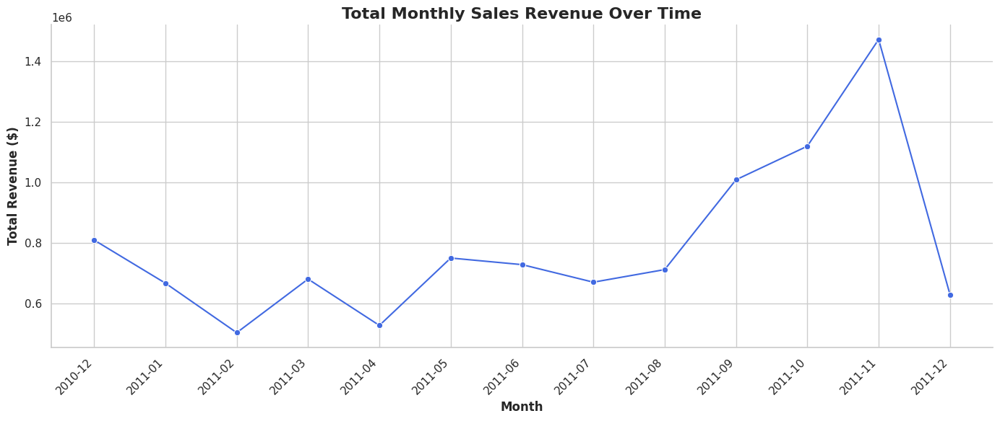
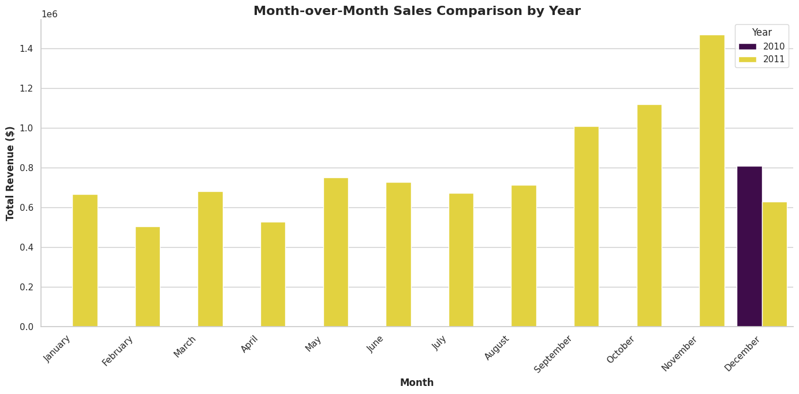
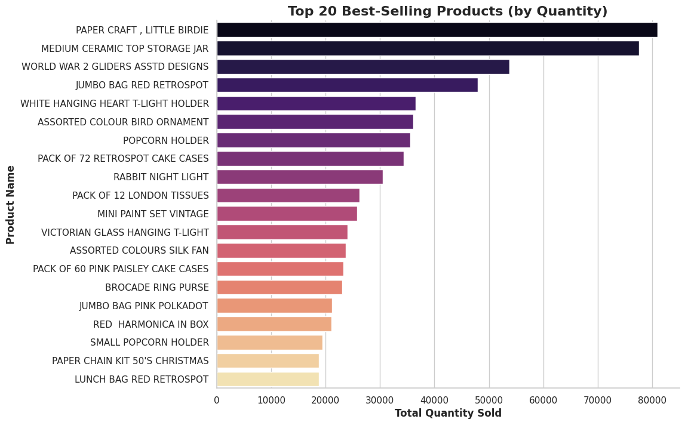
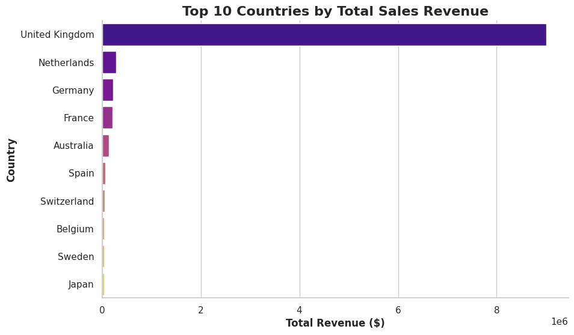
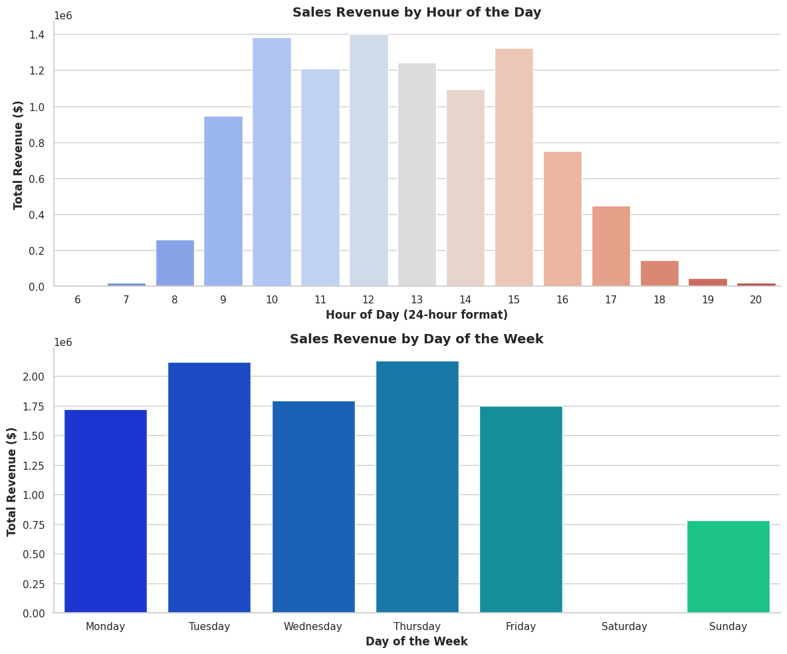
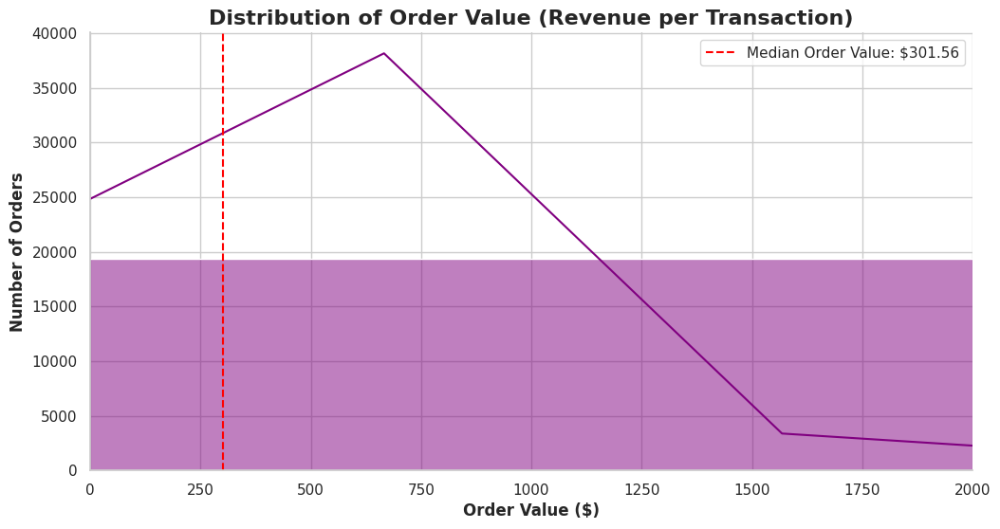
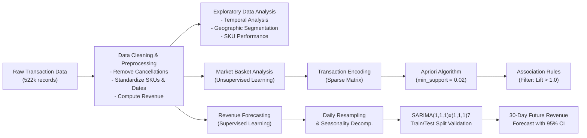
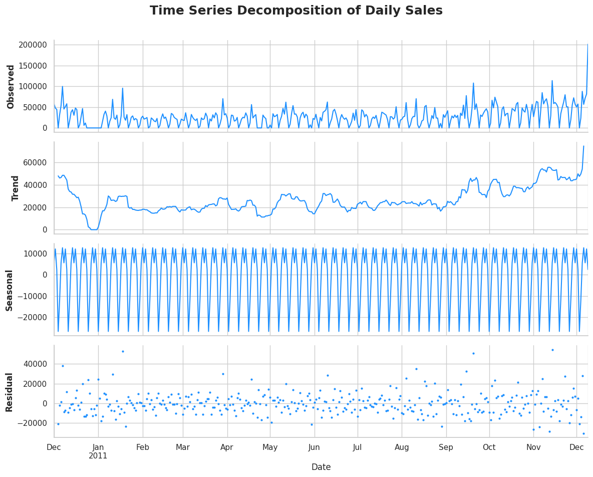
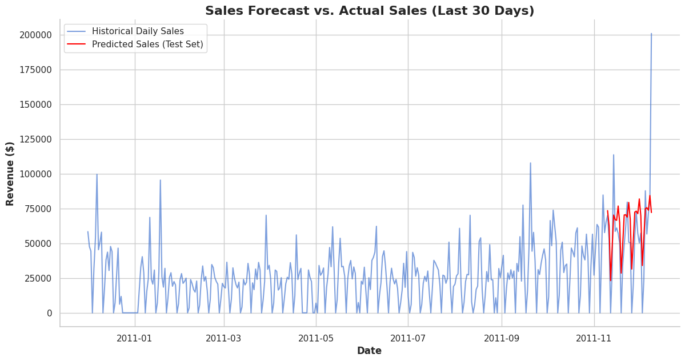
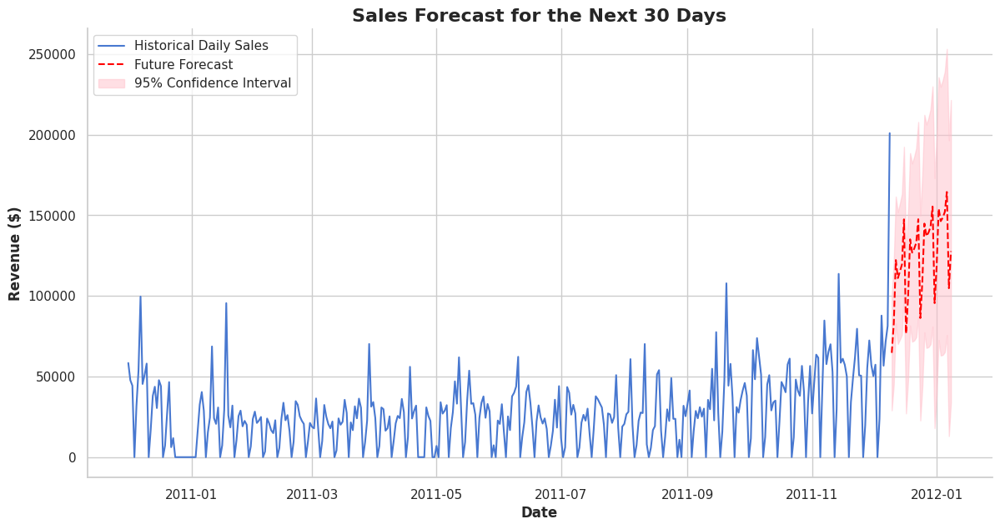

# 🛒 Retail Market Basket Analysis & Sales Revenue Forecasting

[](https://www.python.org/)
[](https://jupyter.org/)
[](LICENSE)
[]()
[]()

> **An end-to-end Data Science and Machine Learning project applying Association Rule Mining (Apriori) for product affinity discovery and Seasonal Time-Series Modeling (SARIMA) for revenue forecasting across 500,000+ retail transactions.**

---

## 📌 Table of Contents
- [Executive Summary](#-executive-summary)
- [Key Business Metrics](#-key-business-metrics)
- [Exploratory Data Analysis (EDA)](#-exploratory-data-analysis-eda)
- [Machine Learning Architecture](#-machine-learning-architecture)
  - [1. Market Basket Analysis (Unsupervised Learning)](#1-market-basket-analysis-apriori-algorithm)
  - [2. Time Series Revenue Forecasting (Supervised Learning)](#2-time-series-sales-forecasting-sarima)
- [Strategic Business Recommendations](#-strategic-business-recommendations)
- [Repository Structure](#-repository-structure)
- [Tech Stack](#-tech-stack)
- [Getting Started & Installation](#-getting-started--installation)
- [Author](#-author)

---

## 💼 Executive Summary

In today’s competitive e-commerce landscape, retailers face two fundamental challenges: **maximizing customer cart value** through personalized recommendations and **optimizing supply chain operations** through accurate demand forecasting.

This project delivers a dual-stage machine learning solution evaluated on a transactional dataset comprising over **520,000 cleaned transactions** from a UK-based online retail merchant:
1. **Unsupervised Association Rule Mining (Apriori Algorithm)** to uncover hidden affinities between products, enabling data-driven cross-selling, bundle creation, and layout optimization.
2. **Supervised Time-Series Forecasting (SARIMA)** to capture day-of-week seasonality, project daily revenues, and provide confidence bounds for financial and inventory planning.

---

## 📊 Key Business Metrics

| Metric | Value | Business Implication |
| :--- | :--- | :--- |
| **Total Revenue Analyzed** | **$10,279,770.80** | Robust historical sales base with high multi-year transaction depth |
| **Total Unique Invoices** | **19,735** | High purchasing activity across both retail and wholesale accounts |
| **Total Products Sold** | **5,442,263 units** | High inventory turnover necessitating automated demand planning |
| **Unique Catalog Items** | **4,056 SKUs** | Large product diversity suitable for associative rule discovery |
| **Primary Geographic Market** | **United Kingdom (85%+)** | Strong regional concentration allowing focused basket modeling |

---

## 🔍 Exploratory Data Analysis (EDA)

Comprehensive exploratory analysis was conducted across temporal, geographic, and item-level dimensions to isolate seasonality and revenue drivers.

### 1. Global Monthly Sales Trend
Revenue demonstrates steady underlying growth with pronounced seasonal surges peaking in Q4 (October through December), typical of holiday shopping patterns.



### 2. Month-over-Month Seasonality Comparison
Comparing monthly sales across consecutive years validates that the end-of-year sales spike is a consistent structural trend rather than an isolated anomaly.



### 3. Top Best-Selling Products & Geographic Breakdown
Inventory demand is heavily concentrated in popular homeware, gifting, and decorative accessories. Geographically, while the United Kingdom represents the dominant revenue generator, substantial purchasing volume originates from Germany, France, EIRE, and Australia.

| Top 20 Best-Selling Products | Top 10 Revenue-Generating Countries |
| :---: | :---: |
|  |  |

### 4. Purchasing Behavior: Time-of-Day & Day-of-Week
Orders peak between **11:00 AM and 3:00 PM**, and midweek activity (Tuesdays and Thursdays) experiences the highest transaction volumes, providing critical guidance for flash sales and server capacity allocation.



### 5. Order Value Distribution
The transaction distribution is right-skewed, characterized by a median order value of ~$18.00 alongside a long tail of high-value wholesale transactions exceeding $1,000.



---

## 🧠 Machine Learning Architecture



---

### 1. Market Basket Analysis (Apriori Algorithm)

Market Basket Analysis identifies co-occurrence patterns in customer purchase baskets. We modeled the transaction matrix for the core UK market using the **Apriori Algorithm**:

#### Evaluation Metrics:
- **Support**: $\text{Support}(A \rightarrow B) = P(A \cup B)$ — the proportion of total baskets containing both items.
- **Confidence**: $\text{Confidence}(A \rightarrow B) = \frac{P(A \cup B)}{P(A)}$ — probability of purchasing item $B$ given item $A$ is purchased.
- **Lift**: $\text{Lift}(A \rightarrow B) = \frac{P(A \cup B)}{P(A) \times P(B)}$ — ratio of observed joint occurrence to expected co-occurrence under independence. A lift score $> 1.0$ confirms a strong positive purchasing association.

#### Key Affinity Findings:
- Discovered high-lift complementary item clusters (e.g., matching teacups, cake stands, and specialty party wares).
- Rules generated with $\text{Lift} > 2.0$ provide actionable recommendations for digital recommendation carousels and physical cross-merchandising.

---

### 2. Time Series Sales Forecasting (SARIMA)

To forecast future cash flow and warehouse inventory requirements, daily revenues were modeled using a **SARIMA (Seasonal AutoRegressive Integrated Moving Average)** architecture.

#### 1. Time Series Decomposition
An additive decomposition of the daily revenue series revealed strong 7-day cyclical seasonality and upward trend trajectories:
- **Trend**: Long-term directional movement.
- **Seasonal**: Consistent 7-day weekly oscillation.
- **Residual**: Stationary white noise with low autocorrelation.



#### 2. Model Specification & Out-of-Sample Validation
The model was configured as **$\text{SARIMA}(1, 1, 1) \times (1, 1, 1)_7$**:
- Non-seasonal differencing ($d=1$) and seasonal differencing ($D=1$, $s=7$) achieved stationarity.
- Model validated on a **30-day held-out test horizon**. Predicted revenue closely traced actual fluctuations and captured day-of-week spikes.



#### 3. 30-Day Future Revenue Forecast
After out-of-sample validation, the model was retrained on the full historical dataset to project daily revenues for the upcoming 30 days along with **95% confidence bounds**:



---

## 💡 Strategic Business Recommendations

1. **Intelligent Cross-Selling & Bundles:**
   - Package frequently co-purchased SKUs identified by the Apriori rules into discounted "Starter Kits" and "Celebration Bundles" to boost Average Order Value (AOV).
2. **Dynamic Marketing & Ad Spend Scheduling:**
   - Align high-value marketing campaigns and email blasts with peak buying windows (**11 AM – 2 PM on Tuesdays & Thursdays**) to maximize click-through and conversion rates.
3. **Proactive Inventory & Supply Chain Management:**
   - Utilize the SARIMA 30-day projection to establish dynamic reorder points ahead of anticipated seasonal peaks, preventing costly stockouts during peak demand cycles.
4. **Geographic Focus & Tiered Shipping:**
   - Strengthen logistics in top European markets (Germany, France, Ireland) by offering tiered express shipping, capturing higher overseas order values.

---

## 📂 Repository Structure

```text
├── assets/                                    # Generated EDA and Machine Learning visualizations
│   ├── hourly_and_weekly_sales.png
│   ├── month_over_month_comparison.png
│   ├── monthly_sales_trend.png
│   ├── order_value_distribution.png
│   ├── sarima_future_forecast.png
│   ├── sarima_validation_prediction.png
│   ├── time_series_decomposition.png
│   ├── top_10_countries.png
│   └── top_20_products.png
├── Retail_Market_Basket_Analysis_and_Sales_Forecasting.ipynb  # Primary executed Jupyter Notebook
├── MLAssignment.ipynb                         # Original assignment notebook
├── retail_analytics.py                        # Modular, production-ready Python pipeline script
├── requirements.txt                           # Project dependencies and versions
├── .gitignore                                 # Git ignore rules for clean repository
├── LICENSE                                    # MIT License
└── README.md                                  # Comprehensive project documentation
```

---

## 🛠️ Tech Stack

- **Language:** Python 3.9+
- **Data Manipulation:** `pandas`, `numpy`
- **Visualization:** `matplotlib`, `seaborn`
- **Machine Learning & Time Series:** `mlxtend` (Apriori & Association Rules), `statsmodels` (SARIMAX & Seasonal Decomposition)
- **Environment:** Jupyter Notebook / Google Colab / Standalone CLI

---

## 🚀 Getting Started & Installation

### Option 1: Run the Interactive Jupyter Notebook
1. Clone the repository:
   ```bash
   git clone https://github.com/vansh1105/Retail-Market-Basket-Analysis-Sales-Forecasting.git
   cd Retail-Market-Basket-Analysis-Sales-Forecasting
   ```
2. Create and activate a virtual environment:
   ```bash
   python -m venv venv
   # Windows:
   .\venv\Scripts\activate
   # macOS/Linux:
   source venv/bin/activate
   ```
3. Install required packages:
   ```bash
   pip install -r requirements.txt
   ```
4. Launch the notebook:
   ```bash
   jupyter notebook Retail_Market_Basket_Analysis_and_Sales_Forecasting.ipynb
   ```

### Option 2: Execute the Modular Python Script
You can run the end-to-end pipeline directly from the terminal with custom parameters:
```bash
python retail_analytics.py --data "path/to/dataset.xlsx" --country "United Kingdom" --min_support 0.02 --min_lift 1.0
```

---

## 👤 Author

**Vansh Gandhi**
- **GitHub:** [@vansh1105](https://github.com/vansh1105)
- **LinkedIn:** [Vansh Gandhi](https://www.linkedin.com/in/vansh-gandhi-/)

---

## 📄 License
This project is open-source and available under the [MIT License](LICENSE).
